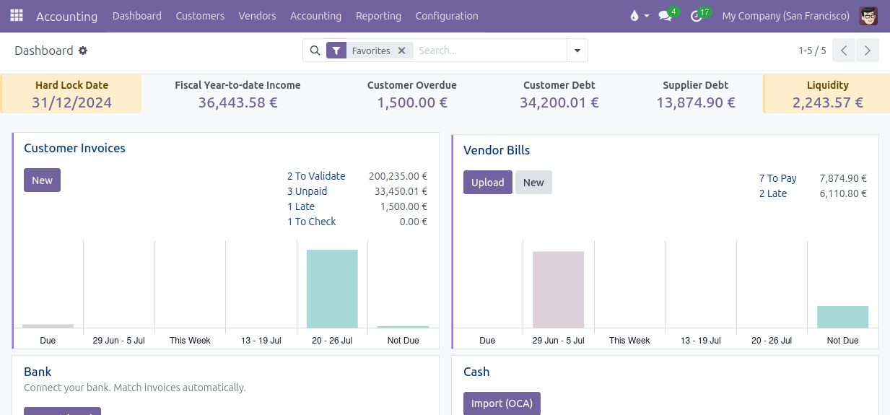

Enjoy the accounting dashboard with the banner at the top:

When several companies are selected in the company switcher, each cell
shows one total for the selected companies. When they have several
currencies, a selector in the banner chooses the currency of the totals
(the one of the current company by default, the choice is kept by the
browser): the amount of a company in that currency is taken as is, the
others are converted at the latest known rate. Lock dates are set per
company: a lock date cell shows the oldest lock date of the selected
companies, up to which all of them are locked.

A cell can be hidden from the banner without deleting it: uncheck
*Displayed* in *Accounting > Configuration > Dashboard > Dashboard Banner
Cells*.
